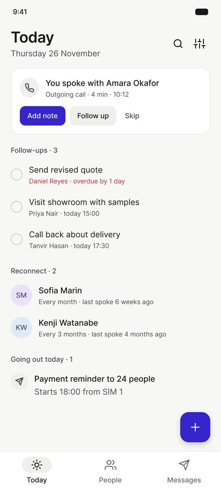
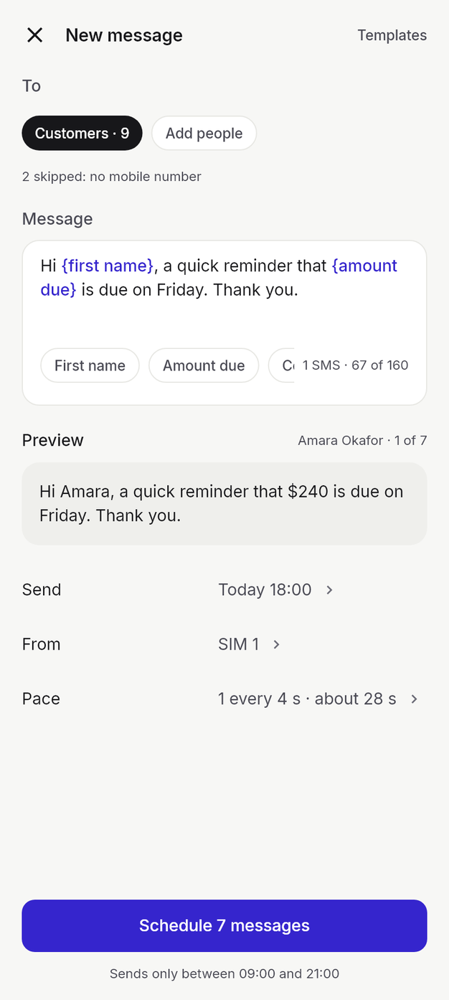

# PocketCRM

A private, on-device relationship manager for Android. PocketCRM logs calls and SMS per person automatically, lets you add a note in seconds after a call or visit, reminds you to follow up and stay in touch, and sends scheduled and bulk personalised SMS directly from your phone's own SIM. Nothing leaves your phone.

- **Landing page & download:** https://tanzir71.github.io/git-pocket-crm/
- **Latest APK:** https://github.com/tanzir71/git-pocket-crm/releases/latest/download/PocketCRM.apk

<p align="center">
  
  &nbsp;&nbsp;&nbsp;
  
</p>

## Privacy

PocketCRM has **no servers, no accounts, no analytics, and no internet permission**. The release build literally cannot connect to the network; `tool/check_manifest.sh` inspects the merged Android release manifest on every build and fails if `android.permission.INTERNET` appears or if any permission differs from the explicit allow-list in [`tool/allowed_permissions.txt`](tool/allowed_permissions.txt).

## Installing from a file

1. Download [`PocketCRM.apk`](https://github.com/tanzir71/git-pocket-crm/releases/latest/download/PocketCRM.apk) (and optionally verify its checksum against `PocketCRM.apk.sha256` from the [latest release](https://github.com/tanzir71/git-pocket-crm/releases/latest)).
2. Open the APK on your Android phone and allow your browser or file manager to install apps if Android asks.
3. Open PocketCRM and walk through the five-step setup screen. On Android 13 and later, Android blocks SMS and Call Log permissions for apps installed from a file until you allow restricted settings:
   - Tap **Open app info** in PocketCRM's setup guide.
   - Tap the three dots at the top right, tap **Allow restricted settings**, and confirm with your screen lock.
   - Return to PocketCRM and tap **Allow** again.

## Why PocketCRM is not on Google Play

Google Play's [SMS and Call Log Permissions policy](https://support.google.com/googleplay/android-developer/answer/10208820) restricts apps from reading call history or sending SMS unless they replace the phone's default dialer or messaging app. PocketCRM is a companion relationship manager, not a dialer or default SMS app, so it is distributed directly as a signed APK from GitHub Releases and the source is on GitHub for anyone to inspect.

## Building from source

Requires Flutter 3.50+ and the Android SDK.

```sh
flutter pub get
dart run build_runner build --delete-conflicting-outputs
bash tool/verify.sh       # analyze, unit/widget/golden tests, debug APK, manifest allow-list, landing page check
bash tool/build_apk.sh    # signed release APK at build/PocketCRM.apk (requires ~/.pocketcrm/key.properties)
```

For a release build, create `~/.pocketcrm/key.properties` (or point `PCRM_KEY_PROPERTIES` at your properties file) with `storeFile`, `storePassword`, `keyAlias`, and `keyPassword`. Release builds fail if signing properties are missing and never fall back to a debug key.

## Project layout

- `lib/core/` — Drift v5 SQLite database (`app_database.dart`, `crm_queries.dart`), theme tokens, Inter typography, reusable widgets, Pigeon native API bindings, GoRouter shell, and formatters.
- `lib/features/` — Feature modules: `today`, `people`, `capture`, `history`, `followups`, `payments`, `messages`, `sync`, `setup`, `settings`, `backup`.
- `lib/l10n/` — ARB localizations (`app_en.arb`, `app_bn.arb`).
- `android/app/src/main/kotlin/com/pocketcrm/pocket_crm/` — Native Kotlin call/SMS sync reader, `PhoneStateReceiver`, native SMS outbox (`outbox/`), and Storage Access Framework backup bridge (`backup/`).
- `docs/` — Static zero-JS landing page served via GitHub Pages.
- `tool/` — Local verification, permission allow-list, APK build, and release scripts (`verify.sh`, `check_manifest.sh`, `allowed_permissions.txt`, `build_apk.sh`, `release.sh`, `check_landing.sh`).
- `handover/` — Product direction, design system, specs, decisions, progress, and test logs.

## Not yet proven on real hardware

Automated tests and self-driven Android emulators verify core logic, database migrations, UI goldens, background outbox delivery under Doze/reboot/airplane mode, and setup flows. Behaviours that require physical devices or live carrier networks (mobile operator filtering, dual-SIM hardware, sideloaded Android 13+ restricted settings, OEM battery managers, physical GPU startup/frame timings, and native Bengali copy review) are documented plainly in [`handover/UNVERIFIED.md`](handover/UNVERIFIED.md).
